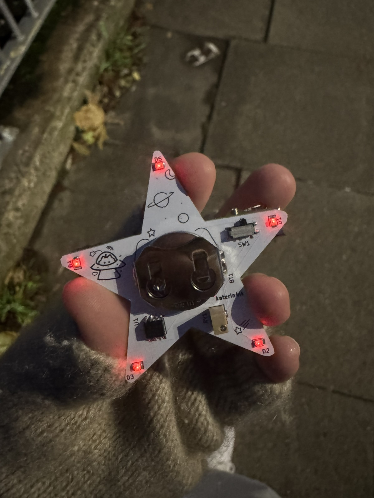
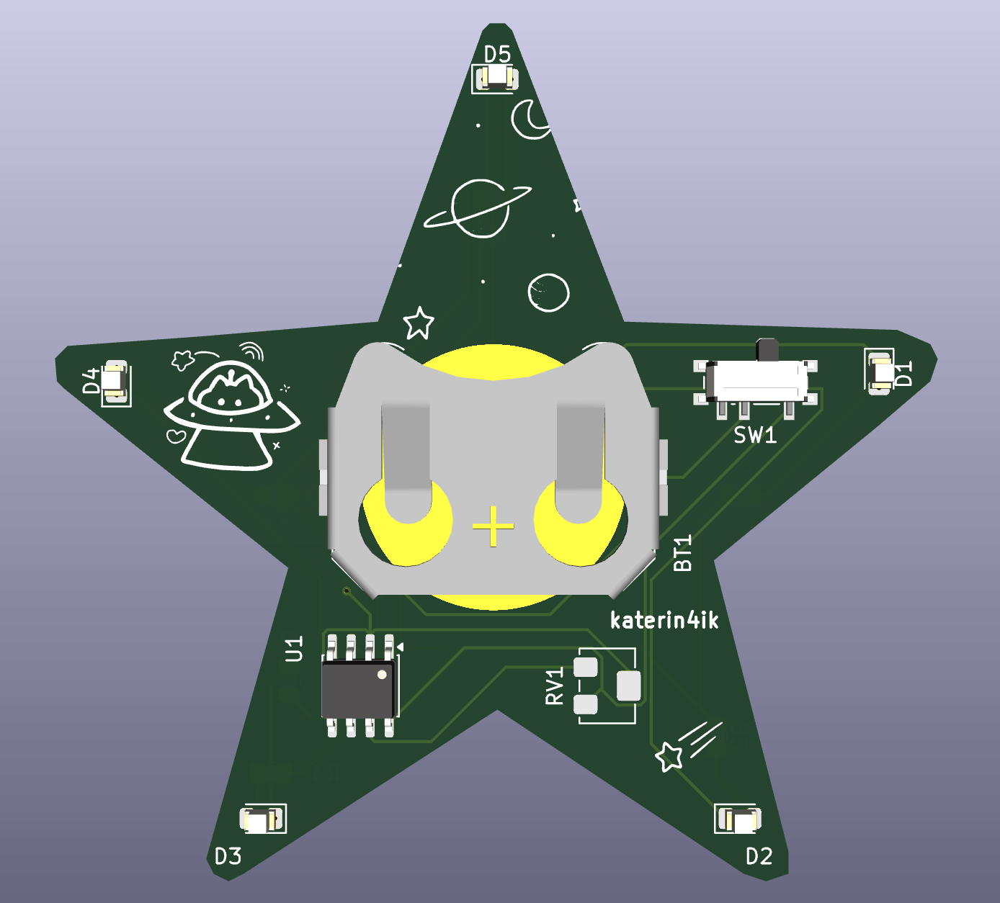

# StarLight

Variable-speed blinking LED star PCB designed in KiCad.

A 5-pointed star with 5 LEDs driven by a 555 timer.
Speed is controlled by a potentiometer. Powered by a CR2032 coin cell.

## Watch it working

<video src="video.mp4" controls width="100%"></video>

Or [download the video](video.mp4)

---

## Features
- 5 × 0805 LEDs
- LM555 timer (SOIC-8)
- Potentiometer speed control
- CR2032 battery holder
- On/Off switch
- Cute space-themed silkscreen
- Ready-to-order Gerber files included

---

## Bill of Materials (BOM)

| Qty | Reference | Component | Value | Footprint | Notes |
|-----|-----------|-----------|-------|-----------|-------|
| 1 | U1 | Timer IC | LM555 / NE555 | SOIC-8 | SMD version |
| 5 | D1–D5 | LED | White or Red 0805 | LED_0805_2012Metric | One per star point |
| 5 | R1–R5 | Resistor | 180–220 Ω | R_0805_2012Metric | Current limiting |
| 1 | RV1 | Potentiometer | 50 kΩ or 100 kΩ | Potentiometer_Bourns_3214W | Speed control |
| 1 | C1 | Capacitor | 100 nF | C_0805_2012Metric | Decoupling |
| 1 | C2 | Capacitor | 10 µF | C_0805 or electrolytic | Timing capacitor |
| 1 | BT1 | Battery holder | CR2032 | Keystone 3034 | Coin cell |
| 1 | SW1 | Switch | SPST | SW_SPDT_PCM12 | On/Off |
| 1 | — | Battery | CR2032 | — | 3 V coin cell |

### What to buy (shopping list)
- 1× LM555 SOIC-8
- 5× LED 0805 (any color you like)
- 5× Resistor 220 Ω 0805
- 1× Potentiometer 100 kΩ (SMD trimmer Bourns 3214W or similar)
- 1× Capacitor 100 nF 0805
- 1× Capacitor 10 µF (0805 or small electrolytic)
- 1× CR2032 battery holder (Keystone 3034 or compatible)
- 1× CR2032 battery
- 1× Slide switch SPST SMD

All parts are easy to find on LCSC, DigiKey, Mouser or AliExpress.

---

## How to order the PCB

### Option 1: JLCPCB
1. Go to [jlcpcb.com](https://jlcpcb.com)
2. Upload the Gerber zip (from the `Gerbers/` folder)
3. Choose:
   - Layers: 2
   - Thickness: 1.6 mm
   - Color: Green (or any)
   - Surface finish: HASL or ENIG
   - Quantity: 5 or 10
4. Order. Usually arrives in 1–2 weeks.

### Option 2: PCBWay
1. Go to [pcbway.com](https://www.pcbway.com)
2. Upload the same Gerber files
3. Same settings as above
4. Order

The Gerber files are already in the `Gerbers/` folder and ready to upload.

---

## How to solder

1. Start with the smallest parts (resistors and LEDs).
2. Then solder the 555, capacitors and switch.
3. Finally solder the battery holder and potentiometer.
4. Use flux and a fine soldering iron tip.
5. For 0805 parts a stencil + hot air or reflow works best, but hand soldering is also possible.

**Tip:** Put the battery holder on the bottom side if you want a cleaner front.

---

## How to make it work

1. Insert a CR2032 battery (positive side up).
2. Turn the switch ON.
3. Turn the potentiometer — the LEDs should start blinking.
4. Faster or slower depending on the pot position.

If nothing happens:
- Check battery polarity
- Check that all solder joints are good
- Make sure the 555 is oriented correctly (pin 1 mark)

---

## License
Open hardware – feel free to use, modify and share.
