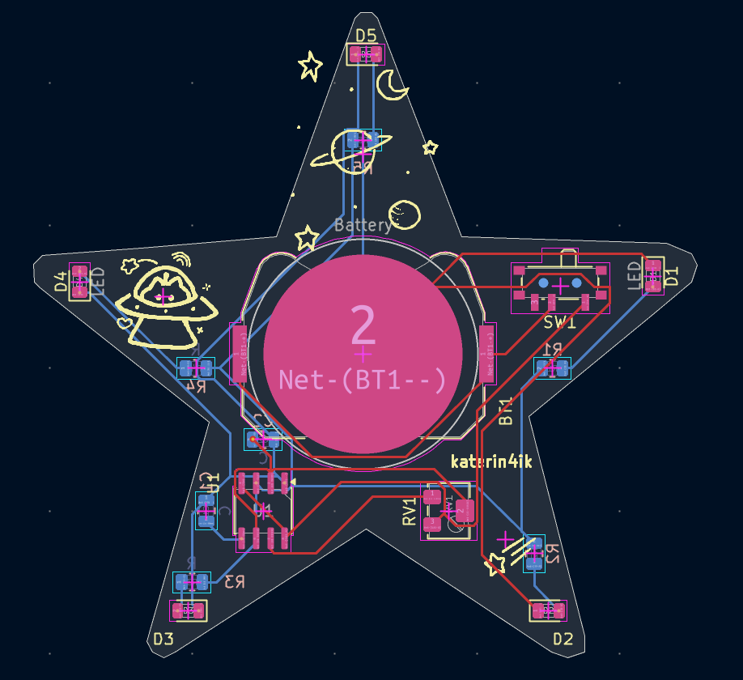

# StarLight

Variable-speed blinking LED star PCB designed in KiCad.

A 5-pointed star with 5 LEDs driven by a 555 timer.
Speed is controlled by a potentiometer. Powered by a CR2032 coin cell.

## Features
- 5 × 0805 LEDs
- LM555 timer
- Potentiometer speed control
- CR2032 battery holder (Keystone)
- On/Off switch
- Cute space-themed silkscreen (stars, planets, alien)
- Ready-to-order Gerber files included

## Files
- KiCad project files (`StarProject.*`)
- Gerber files in `Gerbers/` folder
- BOM in `StarProject.csv`
- Photos: `main.jpg`, `front.png`, `pcbEditor.png`, `back.tiff`

## How to open
1. Install [KiCad](https://www.kicad.org/)
2. Open `StarProject.kicad_pro`

## License
Open hardware – feel free to use, modify and share.
